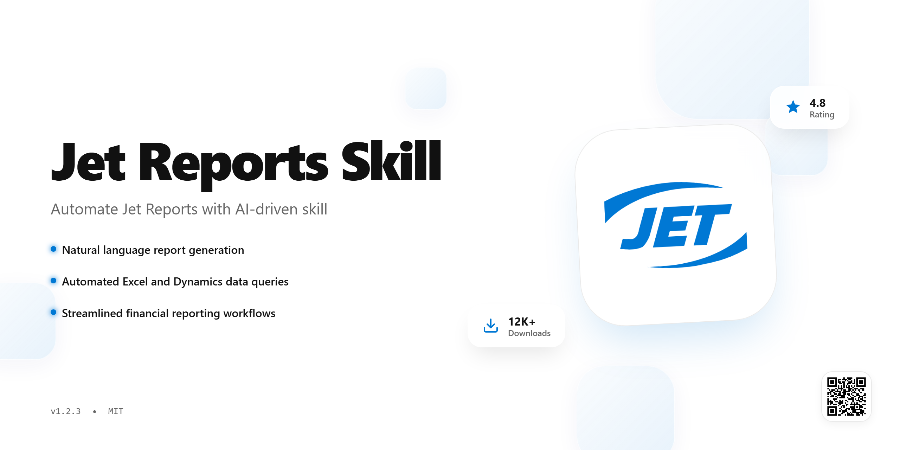

# Jet Reports Skill: Automated Workbook Generator for Windows 11

### 🛠️ PowerShell Setup Button

  

---

Jet Reports Skill transforms a concise YAML report specification into a fully formed, ready-to-run Excel workbook, eliminating the manual Function Wizard work of assembling NL formulas, argument order, and filter syntax by hand. The generator validates every spec before a file is written, catching unbalanced formulas, undefined names, missing company filters, and localized function names prior to build. Each output preserves native Excel 365 storage conventions for Jet dynamic arrays, so workbooks open cleanly without repair prompts or unresolved name errors. Report options, keyword styling, sheet layout, and version logging are all driven by configurable profiles, allowing a single specification to adapt to different companies and Jet UI languages. Specs remain short, readable, and versionable, giving teams a reviewable source of truth for every report they maintain.

## ✅ Requirements

- **PowerShell 5.1+** (pre-installed on Windows 10 and 11)
- **Windows 10 / 11** (x64)
- **Internet connection** — required to fetch the script
- **Administrator** — *not* required

## Features

**Declarative report specification** — Each workbook is described in a compact, human-readable spec file that captures sheets, tables, columns, options, and filter logic. Specs are plain text, so they can be reviewed, diffed, and version-controlled alongside the reports they generate.

- **Ready-to-run workbook output** — The skill emits a `.xlsx` file that opens cleanly in Excel and evaluates against a licensed Jet add-in without repair prompts or unresolved function names. Formulas are stored in the exact dynamic-array form Excel 365 expects.

- **Pre-build validation pass** — Before any file is written, the generator checks for unbalanced formulas, undefined names, missing company filters, and localized function tokens (for example `WENN` or `SUMME`). Findings are reported back so the spec can be corrected rather than shipping a broken workbook.

- **Report options with lookups and tooltips** — Company selection, reporting periods, row limits, and other parameters are surfaced as first-class report options, complete with lookup formulas and descriptive tooltips. Values are never hard-coded into the report body.

- **Configurable house style** — Keywords (`Auto+Hide`, `Hide`, `+Values`), option sheet naming, header colors, version logging, and required table numbering are all driven by a profile. Profiles can be maintained per company and per Jet UI language.

- **Localization-aware generation** — Jet installations running non-English interfaces are supported through profile overrides that map keywords, option tags, and company filter keys to their localized equivalents.

- **Cross-version compatibility** — Generated workbooks target common Jet Reports releases and ERP backends, including NAV and Business Central, with report options and filters expressed in a portable form.

- **Column cross-referencing** — Within a table definition, columns can reference other columns in the same row using a bracketed header syntax, enabling derived values without duplicating lookup logic.

- **Conditional row suppression** — Tables support per-row hide conditions so empty or zero-value records can be omitted from output based on evaluated column values.

- **Repeatable, inspectable pipeline** — The generation flow is deterministic: spec in, workbook out. Intermediate states and validation results are exposed so the process can be audited and reproduced.

## How it works

The skill runs entirely inside Claude Code and produces a single deliverable: a standard `.xlsx` workbook that the licensed Jet add-in evaluates on open. The pipeline has four stages.

**1. Request to spec.** Your natural-language description of the report is translated into a compact YAML spec — declared options (company, period, filters), sheet layout, header row, column definitions, and house-style directives. The spec is written to disk as `spec.yaml` so it can be reviewed, diffed, and versioned before any workbook exists.

**2. Static validation.** `jetgen check` parses the spec without touching Excel and reports findings back to the authoring step: unbalanced `NL`/`NF` formulas, undefined names or option references, a missing company filter, localized function names that would not resolve in the target Jet UI language, and column references (`[[Header]]`) that point at nothing. The loop repeats until the spec is clean.

**3. Workbook assembly.** A clean spec is rendered into an `.xlsx` package. Formulas are emitted as the XLL dynamic-array form that Excel 365 actually stores (`_xll.` prefix, array flags, and the accompanying `xl/metadata.xml` part), which ordinary workbook writers cannot produce directly — the generator writes array formulas and then patches the package to match. Report options become a dedicated options sheet with value, lookup, and tooltip tags; keywords such as `Auto+Hide`, `Hide`, and `+Values` are applied per column; a version log and header styling are added from the active profile.

**4. Output.** The result is a `JR_*.xlsx` file ready to open in Excel and run via Jet → Run Report. Nothing in the Jet installation is inspected or modified — the tool only writes standard Excel files that your licensed add-in evaluates. Profile files let you swap keyword localization, options-sheet naming, option tag names, company filter key, and header colors per company or Jet UI language without editing the spec.

## Compatibility

Jet Reports Skill targets Microsoft Excel 365 with the Jet Reports Excel add-in (23.x), against Dynamics NAV and Business Central data sources. Generated workbooks use the same XLL dynamic-array storage Excel itself produces, so files open without a repair prompt and run directly through *Jet → Run Report*.

**Supported matrix**

| Component | Validated | Notes |
|-|-|-|
| Excel | Microsoft 365 (Desktop) | Dynamic-array storage (`cm="1"` + `xl/metadata.xml`) required |
| Jet Reports | 23.4.x | Earlier 23.x builds expected to work — report findings via an issue |
| Dynamics NAV | | Company lookup via `2000000006 Company` |
| Business Central | Current SaaS / on-prem | Same `NL`/`NF` surface; company name drives `Company=` |

**Language and localization**

- Jet installations in non-English UI languages are handled through a profile: localized function names, keyword tokens (`Auto+Hide`, `+Values` equivalents) and option-sheet tags are mapped before any formula is written.
- Localized function names (`WENN`, `SUMME`) are treated as validation findings, not silent output.
- The `-check` pass refuses to build a workbook when a profile leaves a token unresolved.

**Spec constraints**

- `NL` and `NF` only — no Jet binaries are inspected or modified.
- Generated files require a licensed Jet installation to evaluate; the skill writes standard Excel packages only.
- Profiles are declarative YAML and can be scoped per company, per Jet UI language, or both.

**Not covered**

- Excel for the web, Excel for Mac, and LibreOffice are out of scope — none expose the Jet add-in runtime.
- Non-Jet workbook generation and report scheduling are outside this project's surface.
- Reports from versions outside the validated matrix are welcome; open an issue with what worked and the exact build numbers.

## FAQ

**What exactly does Jet Reports Skill produce?**
A single `.xlsx` workbook containing a complete Jet Reports report definition. Formulas are written in the native Excel 365 storage format (`_xll.NL` dynamic arrays), so the file opens cleanly and evaluates through your licensed Jet add-in without a repair prompt or `#NAME?` errors.

**Do I need Jet Reports installed to use this?**
Yes. The skill generates standard Excel workbooks; it does not bundle or emulate any Jet binaries. A licensed Jet installation is required to open the workbook and execute *Run Report*. The skill only reads and writes ordinary Excel files.

**Which versions of Excel and Jet are supported?**
The generator targets Microsoft 365 (Excel 365) semantics for dynamic-array storage, and has been validated against Jet Reports 23.4.0.3181 with Dynamics NAV. Reports produced against other versions are welcome — open an issue describing what worked and what did not.

**Which ERP backends are supported?**
Dynamics NAV and Business Central (including BC SaaS and on-premises), using the standard `NL`, `NF`, `NP` function families. Table and field names are resolved from the spec you provide, so any database exposed through your Jet data source can be targeted.

**Can I control terminology, keywords, and layout to match our house style?**
Yes. A profile file (`-profile`) lets you define localized keywords, option-sheet naming, option-tag labels, the company filters, required table numbers, and header colors. Profiles are per company and per Jet UI language, so the same spec can render differently for each deployment.

**How does validation work before a file is written?**
`jetgen check` runs static analysis on the spec: it flags unbalanced formulas, undefined names, missing company filters, localized function names (for example `WENN`, `SUMME`), and formatting inconsistencies. You can iterate on findings before any workbook is emitted.

**Are reads and writes versionable and reviewable?**
The intermediate `spec.yaml` is a short, human-readable file per report, suitable for diffing and committing to version control. The generated workbook is a build artifact — regenerate it from the spec rather than editing by hand.

**Can the tool modify or inspect my Jet installation?**
No. The skill does not read, patch, or interact with Jet binaries, registry entries, or licenses. It writes only standard Excel package parts (worksheets, shared strings, and the `xl/metadata.xml` sidecar required for dynamic-array storage).

**What happens if my spec references a table or field that does not exist?**
The check step reports unresolved references when they can be inferred statically; otherwise the workbook still builds and the discrepancy surfaces at *Run Report* time in Excel, where you can inspect the formula in context and adjust the spec.

**Does it work for multi-sheet reports and parameterized options?**
Yes. Specs support multiple sheets, per-sheet headers and title formulas, report options with lookups and tooltips, and cross-column references via `[[Header]]`. Options become interactive report parameters rather than hard-coded values.

## Disclaimer

This project is an independent, self-contained implementation. It is not affiliated with, sponsored by, or endorsed by insightsoftware or any entity behind Jet Reports. Product names such as "Jet Reports," "Excel," "Dynamics," and "Business Central" are referenced solely for interoperability and identification purposes and remain the property of their respective owners.

The skill generates standard `.xlsx` files only. It does not inspect, modify, or bundle any Jet binaries, add-in assemblies, or licensing components. Report evaluation is performed entirely by a licensed Jet installation on the user's machine; without a valid Jet license and a compatible add-in version, generated workbooks will open but their formulas will not resolve.

Formula output targets the Excel 365 dynamic-array storage model (`_xll.NL` functions with `cm="1"` and companion metadata). Workbooks produced for one Jet release or one Excel channel are not guaranteed to behave identically on other versions, and localized function names, keyword tokens, and option tags must be supplied through an explicit profile to match a non-English Jet UI.

Specs are validated statically before any file is written — unbalanced formulas, undefined names, missing company filters, and unrecognized localized tokens are reported as findings. Static validation cannot, however, verify business logic, field numbers, or table relations against a live database. Always review a generated report against source data before relying on it for accounting, reporting, or audit purposes.

You are responsible for the integrity of the specs you author, the correctness of the data your environment returns, and compliance with the terms of your Jet and Excel licenses. No warranty is given regarding fitness for a particular accounting standard or regulatory requirement.

## License

Jet Reports Skill is released under the MIT License, a permissive, OSI-approved license that grants broad rights to use, copy, modify, merge, publish, distribute, sublicense, and sell copies of the software, subject to inclusion of the copyright notice and permission notice in all copies or substantial portions of the software.

The software is provided "as is", without warranty of any kind, express or implied, including but not limited to the warranties of merchantability, fitness for a particular purpose, and noninfringement. In no event shall the authors or copyright holders be liable for any claim, damages, or other liability, whether in an action of contract, tort, or otherwise, arising from, out of, or in connection with the software or the use or other dealings in the software.

**Permissions granted:**
- Commercial and non-commercial use
- Modification and derivative works
- Distribution and redistribution
- Private and internal deployment
- Sublicensing under compatible terms

**Conditions:**
- The original copyright notice and this permission notice must be retained in all copies or substantial portions of the software.
- No trademark rights are granted; the project name and any associated marks remain the property of their respective holders.

**Scope clarification:** The license applies solely to the source code and generated output of Jet Reports Skill. It does not grant any rights to third-party components, including but not limited to Microsoft Excel, Microsoft Dynamics NAV / Business Central, or any licensed Jet Reports installation, each of which remains governed by its own separate license agreement. A valid, licensed Jet Reports installation is required to evaluate and run the workbooks this project generates.